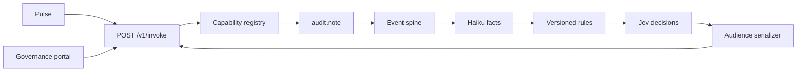

# NewCat

NewCat is a headless clinical audit engine. Pulse (the EHR) and the Governance portal call it. There is no product user interface. `GET /health` reports that the process is up and whether Jev is configured.

Phase 0 audits a synthetic OPD note: ingest the note version, extract typed facts, apply versioned rules, ask closed decision questions, and return an audience-safe envelope. Other capabilities are registered and return `unavailable`.



## Run locally

```bash
npm ci
npm test
npm run example
npm run dev
```

The dev server listens on `PORT` (default `43123`). Without `DATABASE_URL` it uses an in-memory Postgres. Set `NEWCAT_LLM=fake`, `NEWCAT_JEV=fake`, and `NEWCAT_EMBED=fake` to run the synthetic path. A production boot refuses to start unless the required secrets are set, and it refuses the fake providers. When `JEV_BASE_URL` or `JEV_API_KEY` is unset, production still boots, logs a warning, and Jev-dependent decisions return `unavailable`. `GET /health` then includes `"jev": "unavailable"`.

```bash
curl http://127.0.0.1:43123/health
```

`POST /v1/invoke` needs `Authorization: Bearer <api key>` and `Content-Type: application/json`. Keys come from `API_KEYS_JSON` at process start. The example script uses fakes in process and does not need a running server.

```bash
npm run eval -- --gold fixtures/gold/safety-v1.json --runs 3
npm run eval:jev -- --gold fixtures/gold/safety-v1.json
npm run jev:debug -- syn-ddi-allergy
npm run openapi
npm run migrate
```

`npm run migrate` applies `migrations/*.sql` once and records each file in `schema_migrations`.

`npm run eval` scores the gold gate with the fake decision client. `npm run eval:jev` sends those same findings, plus one planted unsupported claim per finding, through live System One and prints the P(yes) distribution for valid and invalid findings. The safety abstention bar stays 0.97. Without `JEV_BASE_URL` and `JEV_API_KEY` the script reports `not_configured` and does not call the network.

`npm run jev:debug -- <fixture-id>` sends one synthetic gold fixture in both option orders. It prints the exact request body, the full raw response, each raw and normalized P(yes), and the final average. The Authorization header is always shown as `Bearer <redacted>`.

## Environment

Names only. Put values in the process environment or a local `.env` that is not committed. `.env.example` shows the shape.

- `NEWCAT_ENV` — `development`, `test`, or `production`
- `PORT`
- `DATABASE_URL` — Neon-compatible Postgres; omit it for in-memory Postgres
- `BEDROCK_REGION`
- `BEDROCK_MODEL_HAIKU`
- `BEDROCK_MODEL_SONNET`
- `BEDROCK_MODEL_OPUS`
- `BEDROCK_AUTH` — `gcp-federation` (production default), `vercel-oidc`, or `default-chain`
- `GCP_SA_KEY_JSON` — service-account JSON, raw or base64
- `GCP_AUDIENCE`
- `AWS_ROLE_ARN`
- `AWS_STS_REGION` — default `ap-south-1`
- `JEV_BASE_URL` — `https://api.typesafe.ai` with no path. The adapter posts `/v1/systemone`. `TYPESAFE_BASE_URL` is an alias
- `JEV_API_KEY` (`TYPESAFE_API_KEY` is an alias)
- `JEV_MODEL` — code default `jev-latest`, the TypeSafe alias. A live response reports the served id in `model`; current calls return `jev-1.13.0`. `TYPESAFE_MODEL` is an alias
- `CRON_SECRET`
- `WEBHOOK_SIGNING_SECRET`
- `API_KEYS_JSON` — array of `{ name, token, scopes, audience }`
- `CALL_BUDGET_MAX`
- `JEV_BUDGET_MAX`
- `ABSTENTION_BACKLOG_DAYS`
- `NEWCAT_LLM` — `bedrock` or `fake`
- `NEWCAT_JEV` — `live` or `fake` (`http` is an alias of `live`)
- `NEWCAT_EMBED` — `bedrock` or `fake`. Production requires `bedrock`
- `EMBEDDING_MODEL` — default `amazon.titan-embed-text-v2:0`. A model id containing `cohere` uses Cohere embed on Bedrock
- `EMBEDDING_DIMENSIONS` — `1024`
- `EMBED_BUDGET_MAX` — calls charged before each embed request
- `EMBED_BATCH_SIZE` — default `8`
- `EMBED_CONCURRENCY` — in-flight embed calls during import. Default `8`
- `BEDROCK_RERANK` — `off` or `haiku`
- `EPMC_MAX_PAGES` — page cap for `npm run corpus:epmc` (default `4`)
- `WORKER_POLL_MS`
- `MIGRATIONS_DIR`

## Corpus

`npm run corpus:import -- file.jsonl` loads CAT's existing corpus. Each line is one JSON object. The import signs every document `signed_by=cat-corpus-import` and it is searchable immediately. Known licensed names (UpToDate, MKSAP, textbooks, StatPearls, Tintinalli, Goodman) are stored as `licensed_internal` with `doctor_visible=false`. Re-running the same file skips lines already imported. The command requires `DATABASE_URL`.

```json
{"source":"who","title":"Warfarin","section":"Dose","text":"Passage text.","url":"https://example.test/warfarin","licence_class":"open"}
```

`url` and `licence_class` are optional. `licence_class` is `open`, `licensed_internal`, `india_regulatory`, or `commercial_db`. Omitted means `open`, unless the source name is a known licensed corpus.

`POST /v1/internal/corpus/import-sample` accepts the same JSONL, at most 150 lines per call. At concurrency 8 that path embeds about 3 lines a second, inside the 60 second Vercel limit.

`npm run corpus:batch-prepare -- file.jsonl out-dir` re-chunks the file and writes Titan v2 batch-inference JSONL in files of about 50,000 records, plus `manifest.jsonl`. `npm run corpus:batch-load -- output.jsonl manifest.jsonl` reads a Bedrock batch output file and writes the vectors. S3 upload and the batch job stay operator steps. See `docs/BATCH-EMBED.md`.

`npm run corpus:epmc -- queries.txt` fetches the Europe PMC open-access subset for one query per line. It keeps CC BY and CC0, drops NC and ND, and leaves those rows unsigned.

Deploy steps, the worker image, and the key CLI are in `docs/DEPLOY.md`. The IAM role, trust policy, and Bedrock permission policy are in `docs/AWS-SETUP.md`.

## API

`/v1` is the current major version. See `DECISIONS.md` for the deprecation policy. The generated contract is `openapi/v1.json`.

| Method | Path | Auth |
|---|---|---|
| GET | `/health` | none |
| POST | `/v1/invoke` | consumer API key |
| GET | `/v1/jobs/:id` | consumer API key |
| GET | `/v1/events?after=` | consumer API key |
| GET | `/v1/capabilities` | consumer API key |
| POST | `/v1/internal/work/tick` | `CRON_SECRET` bearer |
| POST | `/v1/internal/corpus/import-sample` | admin key, internal audience, at most 150 lines |
| GET | `/v1/internal/aws/probe` | admin key, read-only AWS permission probe |

Registered capabilities: `audit.note` (implemented), `ask`, `med_reconcile`, `ddx`, `appropriateness`, `triage.decide` (schemas only, status `unavailable`).

Synthetic fixtures live in `fixtures/gold/`. They are not clinical records.
