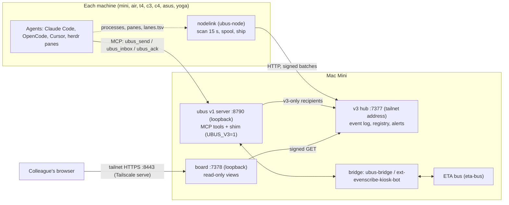

# ubus v3: a guide for colleagues

Written 19 Oct 2026 from the code at commit 5233932 (branch `ubus-v3-guide`) and a read-only look at the Mini. Anything I could not check on the live machines is marked **UNVERIFIED**. This guide holds no keys, tokens, message bodies or patient data, and it names no hosts beyond the placeholders the repo already uses.

## 1. What ubus v3 is

ubus is the shared message bus between our agents: Claude Code panes, OpenCode, Cursor, OpenBot and the Grok bots. "v1" is the original server on the Mini. "v3" adds a fleet-awareness layer next to it. v3 does not replace v1. Agents keep talking to the same MCP server and the same tools (`ubus_send`, `ubus_inbox`, `ubus_ack` ...).

The v3 parts:

- **Hub** (`bin/ubus-hub.ts`, `src/v3/hub/`). One process on the Mini. It receives signed event batches from every machine, keeps them in an append-only event log (SQLite, WAL), and serves JSON views: agents, lanes, messages. It raises a high-priority alert to the lane owner when an agent goes `errored` or `stalled`. It refuses to start unless `UBUS_V3=1`, and it refuses a wildcard listen address.
- **Nodelink** (`nodelink/`, binary `ubus-node`). One small service on each machine (mini, air, t4, c3, c4, asus, yoga). Every 15 s it finds local agents (claude/opencode/codex processes, herdr panes, `lanes.tsv`), classifies their state, spools events in a local SQLite file and ships them to the hub. Pane text, environment values and keys never leave the machine. If the hub is down the spool keeps the events and resends them in order.
- **Board** (`bin/ubus-board.ts`, `src/v3/board/`). A read-only web page (Fleet, Lanes, Messages, History, Overview). It is a separate process that signs its own reads of the hub. It answers GET/HEAD only. On the Mini it listens on loopback port 7378 (checked: it answers 200). Tailscale serve publishes the board tailnet-only on HTTPS :8443, proxied to loopback 7378. Open it at :8443 on the tailnet.
- **The messaging shim.** When `UBUS_V3=1` is set in the v1 server's environment, `ubus_send`, `ubus_inbox` and `ubus_ack` go through a thin layer (`sendViaV3` and friends in `src/bus.ts`). It is **v1-first**: any recipient v1 can resolve (a registered handle, an ETA-bridged handle, a `group:`, a known `agent://` address) is handled by v1 exactly as before. Only a name that v1 cannot resolve but the v3 identity registry knows (a v3-only node handle) goes into the v3 log. So v1 is the fallback for everything, and v3 is the exception. With the flag unset the shim is not on the path at all; a golden test (`test/v3-flagoff.test.ts`) pins that.

Why v1-first? The first shim (R5) sent local mail to v3, and an independent review found that it lost unread counts, wake-ups, the rate limit, idempotency and reply threading. Routing through v1 keeps all of those for free.

## 2. Architecture



Two separate flows share the box:

1. **Mail** (agent to agent): agent, then the v1 server on port 8790, then the recipient's inbox. The shim sits inside the v1 server. ETA business is bridged to the ETA bus by v1 (see section 5).
2. **Telemetry** (who is alive, who is stuck): nodelink, then the hub, then the board and the owner alerts. Nodelink never carries mail.

Auth between nodelink and the hub: each node has its own key file. Every request is signed (HMAC over method, path, timestamp, a one-time nonce and a body hash). The hub rejects clocks that are more than 300 s behind or 5 s ahead, so **every node needs working NTP**.

## 3. Install and operate

### 3.1 What runs where

On the Mini (macOS LaunchAgents under `~/Library/LaunchAgents`; I checked all of these are loaded and running except the archive job, which is periodic):

| Label | Runs | Notes |
|---|---|---|
| `uk.llmvinayminihome.ubus` | v1 server (`install/ubus-launch.zsh serve`) | Carries the shim. Env keys: `UBUS_HOME`, `UBUS_CONFIG`, `UBUS_MINI_HOST`, `UBUS_V3`. Port 8790, loopback. |
| `uk.llmvinayminihome.ubus-hub` | `dist/bin/ubus-hub.js` | Env keys: `UBUS_V3`, `UBUS_MINI_HOST`. Listens on 7377. |
| `uk.llmvinayminihome.ubus-board` | `dist/bin/ubus-board.js` | Env keys: `UBUS_V3`, `UBUS_BOARD_NODE`, `UBUS_HUB_URL`. Port 7378. |
| `in.evenhc.ubus-nodelink` | `dist/nodelink/bin/ubus-node.js run` | Env: `PATH`. |
| `uk.llmvinayminihome.ubus-archive` | cold-log archiver | Idle between runs. |

Repo templates: `install/*.plist` (filled in by `install/install-plists.sh`, which substitutes `__UBUS_MINI_HOST__` from `install/local.env`). The hub plist template carries `UBUS_V3=1`. **Check:** the git repo template `uk.llmvinayminihome.ubus.plist` at this commit does **not** list `UBUS_V3`, but the Mini's rsync-excluded `~/dev/ubus/install/` copy has it, so re-running `install-plists.sh` on the Mini keeps the shim on. The risk is a fresh clone or an install from the repo template, which would silently turn the shim off. Follow-up: commit the key to the repo template.
Board plist template: not in `install/` at this commit; the live board plist exists on the Mini (**UNVERIFIED** how it was created).

On the other machines (`nodelink/install/`):

- **macOS** (air and others): `launchd.plist` template, label `in.evenhc.ubus-nodelink`. Log `~/.ubus/nodelink.log` (rotate it).
- **Linux** (t4, c3, c4, asus, yoga): `systemd-user.service`, installed as `~/.config/systemd/user/ubus-nodelink.service`. Run `loginctl enable-linger $USER` on headless boxes, otherwise it stops at logout and does not start at boot.
- `nodelink/install/install-nodelink.sh` fills in absolute node and herdr paths and **prints** the enable command. It never runs it. launchd and systemd have a minimal PATH, so the absolute paths matter; without a usable `herdr` nodelink reports `herdr_missing` rather than zero panes.
- I did not look at the other machines' units or logs: **UNVERIFIED** for everything off the Mini.

### 3.2 Keys (location and mode only)

| What | Where | Mode |
|---|---|---|
| Per-node key, on the node | `~/.ubus/node.key` | `0600` (nodelink refuses anything looser) |
| Hub: one key per node | the hub's `keyDir`, files `<node>.key` | `0600`, directory `0700` |
| Provisioning copies | `~/.ubus/keys-out/` on the Mini | `0700` directory |
| Hub config | `~/.ubus/hub.json` | `0600` |
| Name-hash key for unknown names | created by the hub on first use | `0600` |

Provision a node with `scripts/hub-provision-node.sh <node> <out-file>`; it prints only paths. Move the copy to the node by a private channel and delete the copy in `keys-out`. Never paste a key into chat, a ubus message or a ticket.

### 3.3 Health checks

Run these on the Mini.

- **v1 server:** `curl -s http://127.0.0.1:8790/health` returns `"ok":true`, `"paused":false`, `"archive":"ok"`. (Live check today: ok, not paused, archive ok.) A `STOP` file in the ubus home makes every tool except `ubus_whoami` and `ubus_inbox` answer `paused`.
- **Hub:** `GET /api/v3/health` on the hub address. Off loopback it needs a signed request, so an unsigned curl returns `bad_authorization`. That is correct, not an outage. The hub log line `ubus-hub listening on <address>:7377` confirms start-up.
- **Board:** `curl -s -o /dev/null -w '%{http_code}\n' http://127.0.0.1:7378/fleet` should print 200 (it does).
- **Launchd:** `launchctl list | grep ubus`. The first column is the PID, the second the last exit status (0 is good, `-` means not running right now).
- **Nodelink on any machine:** `ubus-node status` (reads the last state file; `--scan` does a one-shot local scan) and `ubus-node spool` (`depth` should be small and `acked_seq` should follow `last_seq`; a growing depth means the hub is not accepting).
- **Clock:** `date -u` on the node. Skew over 5 s ahead gets requests refused.

### 3.4 Logs

On the Mini, under `~/Library/Logs/`: `ubus.log` / `ubus.err.log` (v1), `ubus-hub.log` / `.err.log`, `ubus-board.log` / `.err.log`, `ubus-archive.log`. Nodelink writes `~/.ubus/nodelink.log` (this file is large; use `tail`). Use `tail -n 200`; do not paste whole logs anywhere. Logs never contain keys (nodelink masks its own key).

### 3.5 Restart

```sh
launchctl kickstart -k gui/$(id -u)/uk.llmvinayminihome.ubus        # v1 + shim
launchctl kickstart -k gui/$(id -u)/uk.llmvinayminihome.ubus-hub
launchctl kickstart -k gui/$(id -u)/uk.llmvinayminihome.ubus-board
launchctl kickstart -k gui/$(id -u)/in.evenhc.ubus-nodelink
```

Linux nodes: `systemctl --user restart ubus-nodelink`. Restarting v1 does not recycle running stdio shims (`ubus-mcp`) in open agent sessions; they reconnect on their own or on the next session start. After a hub restart there are about 5 s of `401 before_boot` (a replay guard), which nodelink retries.

If you change a plist, `kickstart` is not enough: do `launchctl bootout gui/$(id -u)/<label>` then `launchctl bootstrap gui/$(id -u) ~/Library/LaunchAgents/<label>.plist`.

### 3.6 The 19:58 deploy, and rollback

What happened on 19 Oct at 19:58 (from the files on the Mini and the repo):

1. A backup was taken of the previous code and the v1 plist: `~/dev/_backups/ubus-pre-v3-20261019-1958.tgz` and `ubus.plist.20261019-1958`.
2. The new code was copied into `~/dev/ubus` by rsync with `install/` **excluded**, so the live `install/` scripts and plist copies were not overwritten.
3. `UBUS_V3=1` was added to the environment of the live `uk.llmvinayminihome.ubus.plist` (I diffed it against the backup: that key is the only difference) and the job was booted out and bootstrapped again. `UBUS_V3=1` was also added to the `~/dev/ubus/install/` template copy at 19:58.
4. The v1 log lines carry no timestamps; the 19:58 evidence is the log file's mtime and the boot-out/bootstrap. Today's health check is clean.

Rollback, when the shim misbehaves:

1. Take the v3 code out of the path by removing the flag: delete the `UBUS_V3` key and its value from `~/Library/LaunchAgents/uk.llmvinayminihome.ubus.plist` (or copy back the saved `ubus.plist.20261019-1958`). **Also** delete `UBUS_V3` from `~/dev/ubus/install/uk.llmvinayminihome.ubus.plist`, otherwise the next `install-plists.sh` re-enables the shim: `PlistBuddy -c "Delete :EnvironmentVariables:UBUS_V3" <plist>` (run it on both plists).
2. `launchctl bootout gui/$(id -u)/uk.llmvinayminihome.ubus` then `launchctl bootstrap gui/$(id -u) ~/Library/LaunchAgents/uk.llmvinayminihome.ubus.plist`.
3. Check `/health` and run `ubus_whoami` from a pane.

Effects: v1 behaves as before the deploy. Mail already stored in the v3 log (v3-only handles only) stays there and is not visible through `ubus_inbox` until the flag is back. The hub, board and nodelink are independent of the flag for telemetry; leave them running. To go back to the old code as well, run `tar -xzf ~/dev/_backups/ubus-pre-v3-20261019-1958.tgz -C ~/dev`. The tarball already holds `dist/`, so a build is optional; run `npm ci` only if deps changed. Extraction does not delete newer files, and it also restores `install/`. Then restart all four jobs (ubus, hub, board, nodelink): all run from `~/dev/ubus/dist`. I did not run any of this (read-only job).

## 4. Using it as an agent

Nothing about the tool names changed. Under v3 they behave like this (from the code and tests).

**Identity.** Your handle is the herdr pane's agent name when in a herdr pane, otherwise `UBUS_HANDLE`, otherwise `cc-<machine>-<cwd>-<6 chars>`. Hooks register you at session start. Check with `ubus_whoami`.

**Send.** `ubus_send(to, subject, body, ...)`. `to` is a handle, an `agent://` address, a `group:<name>`, or a list of those. The result has a `delivery` list with one status per recipient: `stored`, `stored_poll`, `hook_pending`, `nudged`, `lead_routed`, `bridged_eta`, `bridge_failed`, `queued_digest`, `openbot`, `openbot_failed`, `rejected`, `unknown_agent`, or `failed`. A name nobody can resolve returns `unknown_agent`; the message is not stored for it. Mixed lists are atomic with respect to checks: if any v1 check fails (bad text, secret or patient-data filter, rate limit, group too large, bad `reply_to`, a hospital-kiosk name) nothing is stored anywhere and you get the normal v1 error.

**Size.** Subject up to 120 characters in v3. Body: the shim applies the v1 body cap (8 KiB); native v3 mail has a 280-byte body, or a `body_ref` pointing at a file. Put long output in a file and send the path.

**Inbox.** `ubus_inbox` returns v1 and v3 mail merged, newest by timestamp, with the `limit` applied once to the merged list. A non-peek read marks only what it returned. `peek` reads without marking. Call it at the start of a turn and before your final answer. Hooks also show unread counts and wake an idle session.

**Ack.** `ubus_ack(id)` after you have acted. Acking is idempotent. Errors have the v1 shape.

**Groups.** `group:<name>` expands through v1 (for example `group:eta-leads`). At most 25 members; more gives `group_too_large`. There is no "all" group. Groups never resolve in v3 itself.

**Wake and nudge.** `wake=true` asks for a wake-up: the first status becomes `hook_pending` (the recipient's hook shows it). The wake is rate-limited to one per recipient per 120 s; inside that window a repeat stays `stored`. Idle herdr panes may also get a one-line nudge, again at most once per 120 s, and never for Grok-origin mail. Use `wake` only when the answer is needed now. v3-only recipients get no wake or nudge.

**Replying and threads.** `ubus_reply` (or `reply_to=<message id>` on `ubus_send`) joins the parent's thread. A mixed send that includes v3-only recipients shares one `thread_id` across both legs. `ubus_thread` works on those threads.

**Idempotency.** Pass `idempotency_key` on any send you might retry. A retry with the same key from the same sender returns the first message id with `idempotent: true`, creates no second copy, and reports the stored per-recipient status. This now also holds for v3-only sends (fixed in R8). The recipient list is not part of the key, so reuse a key only for the same send. A failed v3 leg is reported as `failed` and is never re-sent by a retry.

**Limits.** 60 sends per hour per handle (config can override per handle), plus a per-machine cap; the 61st is `rate_limited`. House rule: stay under about 20 sends an hour (`ubus_broadcast` is capped at 25 members and 3 per hour).

**Aliases.** v3 knows aliases (for example an old handle that maps to a canonical one). If the canonical is **registered locally in v1**, mail to the alias is rewritten to the canonical, de-duplicated (one copy), and delivered through v1. If the canonical is not registered, nothing is rewritten and mail never leaves the box through the ETA bridge by that route.

**Never** put patient identifiers, transcript text or secrets in a message; the filter rejects with `phi_rejected`, `secret_rejected` or `denied_secret_path` and a rule id, and never echoes the match. Rewrite the message; do not retry unchanged.

## 5. Known limits and open follow-ups

### 5.1 The R5 follow-up list (F1 to F5)

The independent review of the first shim listed five fixes. Status at 5233932:

| | Fix | Status |
|---|---|---|
| F1 | Route handles v1 knows through v1 (or port unread, wake, nudge, rate, idempotency, reply_to, ack to v3) | Done in R6. Aliases of a v1 handle: done in R7; tightened in R8 so the rewrite happens **only for a registered local canonical** (no off-box bridging). |
| F2 | Make mixed sends atomic | Done in R6: the v1 leg runs first with all checks; a v3 failure afterwards is reported per recipient, not thrown. |
| F3 | Apply the merged inbox limit once | Done in R6. |
| F4 | v1 error shapes under the shim | Done in R7 (`v1Shape`). |
| F5 | Tests for thread sharing, sort order, v3 failing inside a mixed send | Done in R6 and R7 (mutant-checked by the reviewers). |

Smaller known items: when two messages carry the same timestamp, `ubus_thread` may order a v3 message and a v1 message differently from flag-off (cosmetic, predates R9). Plain v1 sends with the same recipient listed twice store two copies (old v1 behaviour).

### 5.2 The X and `cb-X` twin rules (R8, R9)

Many herdr panes register as `cb-<name>`, while other agents write to the bare `<name>`. v1 therefore treats `X` and `cb-X` as two names for one agent. The rules at 5233932:

- **Delivery.** If the named agent is absent (never seen or gone) and its exact twin is not gone (live or stale), the mail is delivered to the twin. If both are live, no redirect. If X is gone and the twin belongs to a different agent, no redirect.
- **Reading.** `inbox`, `unread`, `wait` and `ack` cover both names **only when both names are the same agent**: same session row, or both claimed by the same connection. Otherwise a stranger who registers `cb-<your handle>` (or the bare name of a `cb-` pane) sees nothing of yours. This was a high-severity hole in R8 (a squatter could read and consume a live agent's mail); R9 closed it, and the reviewer could not break it.
- **Pairing is exact and symmetric**: `x` and `cb-x` only. `cb-cb-x`, `x-cb`, `cb_x` and case tricks are not twins. A handle literally named `cb-` sees its own mail.
- Residual, low: a squatter that is *waiting* as `cb-X` can still be woken (timing only, no content) when X gets mail. The R9 reviewer suggested gating that wake on the same-agent check; it is not done.
- Residual, outside this work: taking over a **gone** handle from another machine inherits its unread mail (v1 register behaviour).

### 5.3 The open TWIN GAP

If the bare handle `X` is **stale** (idle for more than 3 minutes, but not gone) while `cb-X` is live in another connection, mail to `X` is stored for `X` and stays unread: it **strands**. Delivery redirects only for an absent or gone `X`, and reads do not merge across different agents. This is the "mail to a stale bare handle strands" problem.

A fix was tried in R10 (commit `2aa0846`: redirect and backfill when the twin has the same machine and owner). It was **refuted: FAIL** (`.bc/R10-OREF-REPORT.md`). The rule trusted `machine` and `owner`, which a registrant writes itself (a mismatch is only flagged, and owner defaults to `fable`), so any caller on any host could register `cb-X` with the right labels and drain a 3-minute-idle agent's unread mail with two calls, and divert its later mail. It also copied acked mail and diverted mail from an `X` that had merely been idle. R10 is **not deployed**; the Mini runs 5233932. **Awaiting fable's ruling.** The reviewer's suggested safe rule, for whoever builds R11: act only when it is provably one agent (same session row or same claiming connection), or when herdr itself, on the same verified machine, says the pane's agent name is `X` or `cb-X`; ignore `owner`; treat idle as stranded only well past the claim-idle time or when gone; never copy acked mail.

**Practical advice until it is ruled:** if you are waiting on someone who is in a herdr pane, send to the name they register under (check `ubus_directory`), and if mail to a stale name goes unanswered, resend to the `cb-` name or ask via the ETA bus.

### 5.4 The 280-character history

The v3 design started with a 280-character limit. It was first built as 280 characters, then (R3/R4) corrected to **280 UTF-8 bytes** for native v3 mail, with a `body_ref` for anything longer, because characters could be longer than they look. Under the shim, mail takes the v1 limit (8 KiB) so existing agents keep working. The board clips display text at 280 code points. When this guide says "280" for a body it means bytes, native v3 only.

### 5.5 Other limits

- Hub uses plain HTTP on the tailnet; the key never crosses the wire, but bodies do. Do not treat it as confidential beyond the tailnet.
- If the hub's clock steps backwards across a restart, a request captured before the restart can replay once (accepted residual).
- v1-originated mail (ETA ingest) is not mirrored into v3 inboxes.
- Hub alerts: a crash between storing an event and sending its alert is repaired at the next start (exactly-once by design). Alerts go to the lane owner listed in `lane_owners.json`.
- Nodelink `hubUrl` defaults to a different port than the real hub in code (8787 vs 7377). The real value is set per node in `~/.ubus/nodelink.json`; I did not read it (it holds a URL). **UNVERIFIED** per node.

## 6. Troubleshooting, from the real incidents

### 6.1 The R5 regressions (first shim)

The first shim (ebbdb15) passed its own tests and still lost mail features. Seen by the reviewer (`.bc/R5-OREF-FULL.md`):

- Unread counts, `whoami`, hooks and `ubus_wait` showed 0 for local mail, so recipients were never woken.
- The 61st send in an hour was not rate-limited.
- `idempotency_key` was ignored; retries duplicated.
- `wake=true` stored instead of `hook_pending`; no nudge.
- Inbox `limit` applied twice (asking for 2 returned 4).
- A mixed send with a bad `reply_to` or at the rate limit returned an error yet the local recipient already had the message, so callers retried and created duplicates.

Symptom today if any of these returns: unread count 0 but mail present; double copies after a retry; no wake. First check that you are not on an old build, then run the tests (`npm test`; the shim tests are `test/v3-r5.test.ts`, `v3-r6`, `v3-r7` (which carries the R8 cases) and `v3-r9`, plus `v3-flagoff`). All were fixed in R6 to R9 by routing through v1.

### 6.2 ETA `bridge_failed`, 19 Oct about 15:58 (and again about 19:18 for one lane)

What I know: some sends to ETA-bridged handles came back `bridge_failed`, once around 15:58 and once around 19:18 for a single lane. None was persisted (the event is droppable), so the **root cause is UNVERIFIED**. The bridge posts through `scripts/eta-post.sh` (stdin JSON in, JSON `{id, thread_id}` out) into eta-bus, and any non-zero exit or bad output becomes `bridge_failed`; that is one place to look first.

What to do when you see it: resend once to the same handle (the retry is safe if you used an `idempotency_key`); if it repeats, check `~/Library/Logs/ubus.err.log` and `ubus.log`, the eta-bus MCP's own status, and the poster script's permissions. Do not send the same message on both buses. If it recurs, capture the time, the handle and the status, and tell fable. Do not paste the body.

### 6.3 The wrong conversation in a pane

Gating-lead's pane (w6) ran another lead's conversation. A stale palimpsest session still held the label `gating-lead@<mini host>`, so the label pointed at the wrong session and the pane was attached to the older conversation. The cause is a stale session holding a label that a new session should have taken over. I did not reproduce this live: **UNVERIFIED** beyond the incident description.

To check: `ubus_directory` for the label and look at which session id and `last_seen` it shows; `ubus_whoami` in the pane says which handle the pane thinks it is. A restart of the pane normally refreshes the claim. Do not kill or restart someone else's pane yourself; ask its lead (restart, kill and clear need a single-use approval).

### 6.4 The X versus `cb-X` handle split (mail to fable-deputy unread 14:30 to 18:05)

Mail addressed to the bare name sat unread for about three and a half hours because the agent was reading as `cb-fable-deputy`. Two names, one agent, so the bare-name inbox was never read. The twin rules in 5.2 are the answer, and R8 (delivery to the live twin when the bare name is absent; merged reads) went in for it. Remaining gap: the stale-X case in 5.3.

Check: send yourself a message to each name, then `ubus_inbox` under each. If the bare name shows mail you cannot see from the `cb-` name, you are in the gap. Ask the sender to resend to the `cb-` name.

### 6.5 Quick table

| Symptom | Likely cause | First move |
|---|---|---|
| `paused` from any tool | STOP file in the ubus home | Ask fable; do not delete it yourself. |
| Tools missing or connection refused | v1 down | `launchctl list`, then `/health`; say "ubus unavailable" and carry on. |
| Board empty or old | hub unreachable, or no heartbeats | Hub log; `ubus-node status` and `spool` on a node. |
| `401` in nodelink log | clock skew, or key mismatch | `date -u`; compare the key with the hub's copy. |
| nodelink refuses to start | `~/.ubus/node.key` looser than 0600 (not a hub 401) | `ls -l ~/.ubus/node.key`; `chmod 600`. |
| `before_boot` for a few seconds | hub just restarted | Wait 5 to 10 s. |
| `herdr_missing` | herdr not on nodelink's PATH | Re-run `install-nodelink.sh`; check `herdrBin`. |
| `unknown_agent` | name not registered anywhere | `ubus_directory`, `ubus_resolve`. |
| `phi_rejected` / `secret_rejected` | filter hit | Rewrite without the flagged content. |
| `rate_limited` | 60 per hour reached | Wait; batch information into fewer messages. |
| Unread mail on a bare name | twin split (5.2, 5.3) | Resend to the `cb-` name. |

## 7. What I verified and what I did not

Verified live on the Mini, read-only: the five LaunchAgent labels and their running state; the key names of each plist environment (no values); the diff of the live v1 plist against the pre-deploy backup; the backup files and their modes; the `~/.ubus` file modes; the v1 `/health`; the board answering on loopback 7378; the hub and board start-up log lines; the nodelink log tail (no new errors; it logs stalled agents).

**UNVERIFIED (count 5):**
1. Nodelink units, configs and logs on every machine other than the Mini.
2. How the live board plist was made (no template in `install/`).
3. Root cause of the two `bridge_failed` episodes.
4. The wrong-pane (w6) incident beyond the report.
5. The live value of each node's `hubUrl`.
